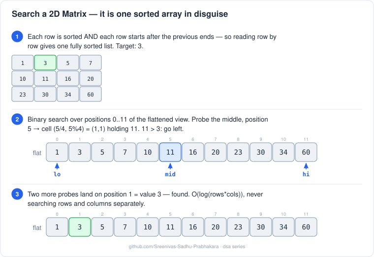

# Search in a 2D Matrix

> Striver SDE Sheet 013 · Day 3 Arrays — one binary search over the matrix viewed as a flattened sorted array. Go, stdlib only, tested.

## Problem

A matrix has every row sorted, and the first element of each row is greater than the last element of the row above — so reading it row by row yields one fully sorted sequence. Decide whether a target value is present in O(log(m·n)).

## Approach

Don't search rows then columns — the sortedness across row boundaries means the matrix *is* a sorted array wearing 2D clothes. Binary search over indices 0..m·n−1, translating each probe index back to a cell with `i/cols` and `i%cols`. Everything else is the textbook binary search, including the overflow-safe midpoint `lo + (hi-lo)/2`.

**Complexity:** O(log(m·n)) time, O(1) space.

## Visual walkthrough

Read the picture top to bottom — each numbered frame is one moment of the algorithm
running on this repo's test example.

## Run

    go test ./...   # verify
    go run .        # demo

---

One of 191 repos solving Striver's SDE Sheet in Go — stdlib only, one problem per repo, every solution tested. Browse the set: [`dsa-*` repos](https://github.com/Sreenivas-Sadhu-Prabhakara?tab=repositories&q=dsa-&type=source).
